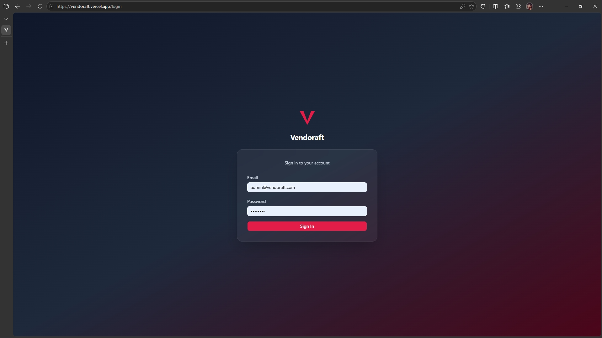
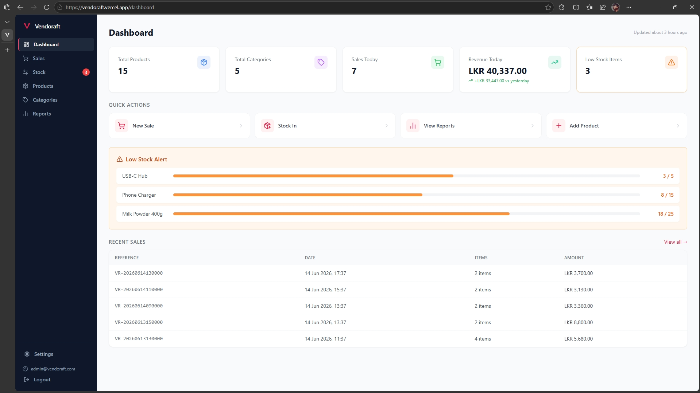
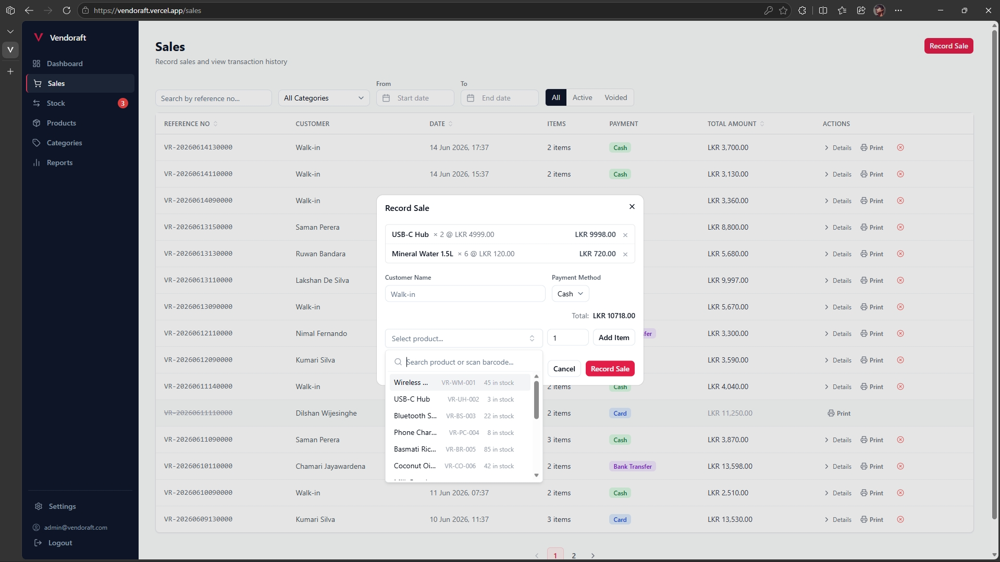
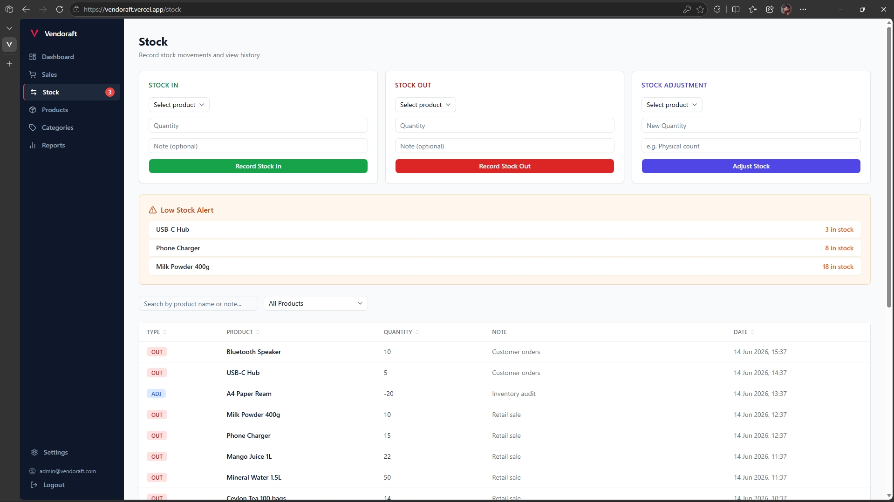
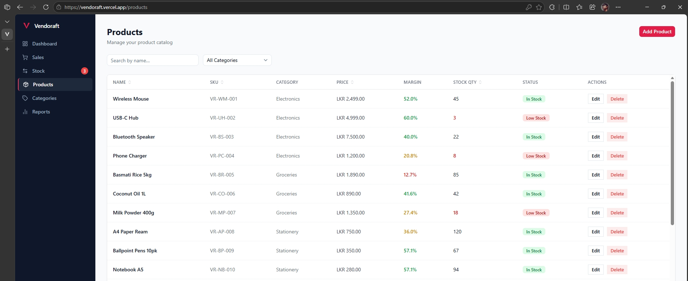
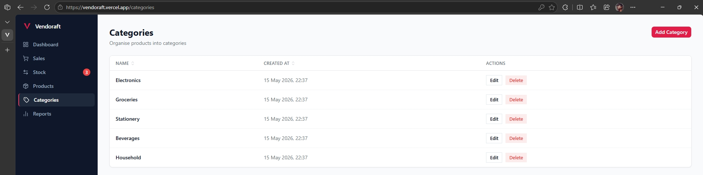
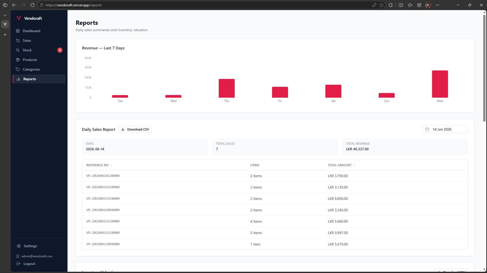
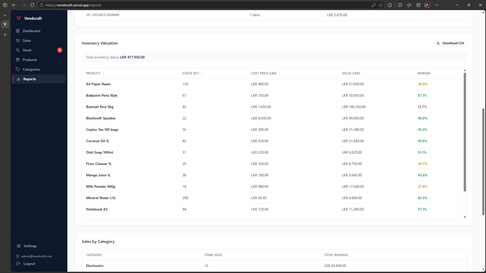
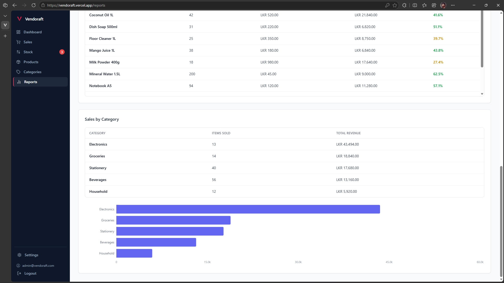
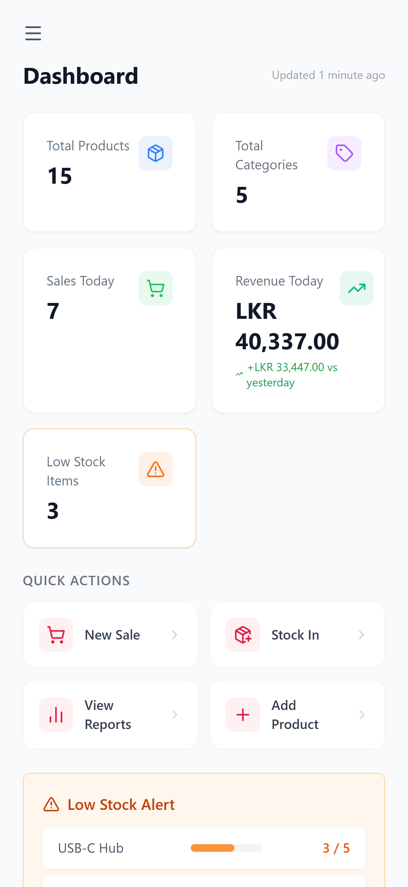

# Vendoraft — Inventory & POS for Small Businesses

> A full-stack point-of-sale and inventory management system with stock tracking, sales recording, void management, and reporting — built for small retail businesses.

[](https://vendoraft.vercel.app) [](https://nextjs.org) [](https://www.typescriptlang.org) [](https://expressjs.com) [](https://neon.tech) [](https://vercel.com)

---

## Live Demo

**Frontend:** [https://vendoraft.vercel.app](https://vendoraft.vercel.app)  
**Backend API:** [https://vendoraft.onrender.com](https://vendoraft.onrender.com)

> Log in with the demo account — no registration required.

| Field    | Value               |
| -------- | ------------------- |
| Email    | admin@vendoraft.com |
| Password | admin123            |

---

## Features

**Product & Category Management**

- Product management with SKU, cost price, selling price, and low-stock threshold
- Category management with product assignment
- Barcode scanner support via SKU lookup on Enter

**Stock Control**

- Stock in, stock out, and direct quantity adjustment
- Full stock movement history with notes and timestamps
- Low-stock alerts with configurable per-product thresholds

**Point of Sale**

- Sales recording with product search, quantity, customer name, and payment method
- Void sales with automatic stock restoration
- Print receipt per sale

**Dashboard**

- KPI tiles: total products, categories, sales today, revenue today, low-stock count
- Revenue trend comparison vs yesterday
- Recent sales table and low-stock progress bars
- Quick action shortcuts

**Reports**

- Daily sales report with date picker
- Inventory valuation with margin percentages
- Sales by category table and bar chart
- 7-day revenue bar chart
- CSV export for sales data

**Security**

- JWT authentication with 7-day expiry
- Rate limiting: 20 req/15 min on auth, 500 req/15 min on API
- CORS locked to production frontend URL
- Helmet HTTP security headers
- bcrypt password hashing (10 rounds)
- Explicit field whitelists on all write endpoints (mass assignment guards)
- Serializable database transactions on all stock-writing operations
- Stack traces stripped from error responses in production

**UX**

- Search and filter on products, sales, and stock pages
- Client-side sorting on all table columns
- Pagination (15 sales/page, 20 movements/page)
- Mobile-responsive with hidden secondary columns on small screens
- Toast notifications for all create/update/delete actions
- Skeleton loaders while data fetches

---

## Tech Stack

| Layer      | Technology                           |
| ---------- | ------------------------------------ |
| Frontend   | Next.js 14 (App Router) + TypeScript |
| Styling    | Tailwind CSS v3 + shadcn/ui          |
| Charts     | Recharts                             |
| Backend    | Node.js + Express                    |
| ORM        | Prisma 5                             |
| Database   | PostgreSQL (Neon)                    |
| Auth       | JSON Web Tokens (jsonwebtoken)       |
| Security   | helmet, express-rate-limit, bcryptjs |
| Testing    | Jest + Supertest                     |
| Deployment | Vercel (frontend) + Render (backend) |

---

## Architecture

```
Browser → Vercel (Next.js 14) → Render (Express API) → Neon (PostgreSQL)
```

The browser loads the Next.js frontend from Vercel. Authenticated API requests go to the Express backend on Render, which queries the Neon PostgreSQL database and returns JSON.

---

## Local Setup

### Prerequisites

- Node.js 18+
- npm
- A [Neon](https://neon.tech) account (free tier works)

### Steps

```bash
git clone https://github.com/minababo/vendoraft.git
cd vendoraft

# Backend
cd backend
cp .env.example .env
# Fill in your values in .env (see table below)
npm install
npx prisma migrate dev
npx prisma db seed
npm run dev          # http://localhost:3000

# Frontend (new terminal)
cd ../frontend
cp .env.example .env.local
# Set NEXT_PUBLIC_API_URL=http://localhost:3000
npm install
npm run dev          # http://localhost:3001
```

### Environment Variables

**Backend (`backend/.env`)**

| Variable     | Description                            |
| ------------ | -------------------------------------- |
| `DATABASE_URL` | Neon PostgreSQL connection string    |
| `JWT_SECRET`   | Random secret, 32+ characters        |
| `PORT`         | API port (default: `3000`)           |
| `NODE_ENV`     | `development` or `production`        |

**Frontend (`frontend/.env.local`)**

| Variable               | Description                              |
| ---------------------- | ---------------------------------------- |
| `NEXT_PUBLIC_API_URL`  | Backend URL (`http://localhost:3000` locally) |

### Database Setup

Run `npx prisma migrate dev` from the `backend/` directory. This applies all migrations in order and seeds the default admin account.

---

## Deployment

**Frontend (Vercel)**

1. Connect the `frontend/` directory to a Vercel project
2. Add `NEXT_PUBLIC_API_URL` pointing to your Render backend URL
3. Deploy — Vercel detects Next.js automatically

**Backend (Render)**

1. Connect the `backend/` directory to a Render Web Service (Node)
2. Set build command: `npm install && npx prisma generate && npx prisma migrate deploy`
3. Set start command: `npm start`
4. Add `DATABASE_URL`, `JWT_SECRET`, `PORT`, `NODE_ENV`, and `FRONTEND_URL` in Render environment variables

---

## Project Structure

```
backend/
  prisma/            — Prisma schema and migration files
  src/
    routes/          — Express route handlers
    middleware/      — Auth, rate limiting, error handling
    lib/             — Prisma client instance

frontend/
  app/               — Next.js App Router pages
  components/        — Reusable UI components
  lib/               — API helpers and utilities
  public/screenshots — Demo screenshots
```

---

## API Reference

| Method | Endpoint                         | Description                         | Auth |
| ------ | -------------------------------- | ----------------------------------- | ---- |
| POST   | `/api/auth/login`                | Login and receive JWT               | No   |
| PUT    | `/api/auth/change-password`      | Change account password             | Yes  |
| GET    | `/api/products`                  | List all products                   | Yes  |
| POST   | `/api/products`                  | Create a product                    | Yes  |
| PUT    | `/api/products/:id`              | Update a product                    | Yes  |
| DELETE | `/api/products/:id`              | Delete a product                    | Yes  |
| GET    | `/api/categories`                | List all categories                 | Yes  |
| POST   | `/api/categories`                | Create a category                   | Yes  |
| PUT    | `/api/categories/:id`            | Update a category                   | Yes  |
| DELETE | `/api/categories/:id`            | Delete a category                   | Yes  |
| GET    | `/api/stock/movements`           | List stock movements                | Yes  |
| POST   | `/api/stock/in`                  | Record stock in                     | Yes  |
| POST   | `/api/stock/out`                 | Record stock out                    | Yes  |
| POST   | `/api/stock/adjust`              | Adjust stock to a specific quantity | Yes  |
| GET    | `/api/sales`                     | List all sales                      | Yes  |
| POST   | `/api/sales`                     | Record a new sale                   | Yes  |
| POST   | `/api/sales/:id/void`            | Void a sale and restore stock       | Yes  |
| GET    | `/api/reports/daily`             | Daily sales report for a given date | Yes  |
| GET    | `/api/reports/valuation`         | Inventory valuation report          | Yes  |
| GET    | `/api/reports/sales-by-category` | Revenue grouped by category         | Yes  |
| GET    | `/api/dashboard`                 | Aggregated KPI data                 | Yes  |
| GET    | `/api/health`                    | Server health check                 | No   |

---

## Database Schema

| Model           | Description                                                                                    |
| --------------- | ---------------------------------------------------------------------------------------------- |
| `User`          | Admin account with hashed password and JWT identity                                            |
| `Category`      | Product grouping with a unique name                                                            |
| `Product`       | SKU, price, cost price, stock quantity, low-stock threshold, and category reference            |
| `StockMovement` | Audit record for every IN, OUT, ADJUSTMENT, or VOID movement against a product                 |
| `Sale`          | Transaction record with reference number, total, payment method, customer name, and void state |
| `SaleItem`      | Line item linking a sale to a product with quantity, unit price, and subtotal                  |

---

## Known Limitations

- Multi-user and role-based access (single admin account only)
- Real-time stock sync across browser tabs
- Supplier management and purchase orders
- Invoice / billing generation

---

## About

Built by Minada Amarasinghe as a final-year undergraduate portfolio project to demonstrate full-stack engineering across a React/Next.js frontend, a secured Express REST API, a relational PostgreSQL database, and a production deployment pipeline.

GitHub: [https://github.com/minababo](https://github.com/minababo) · LinkedIn: [minada-amarasinghe](https://www.linkedin.com/in/minada-amarasinghe-b83591262/)

---

## Screenshots

### Login



### Dashboard



### Sales



### Stock



### Products



### Categories



### Reports







### Mobile View


